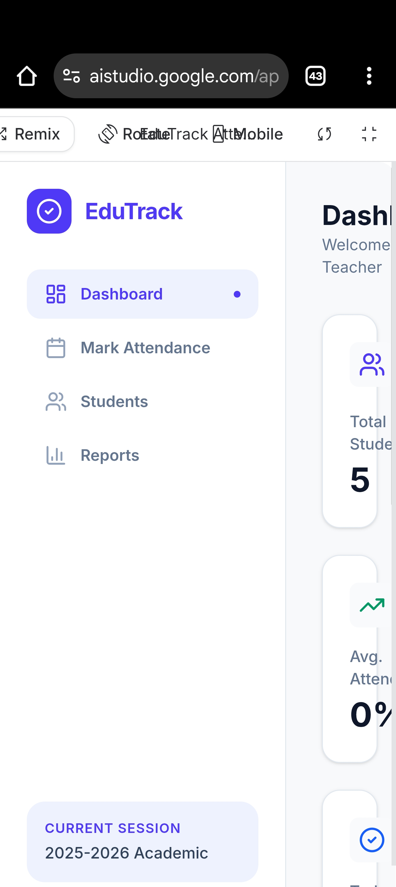
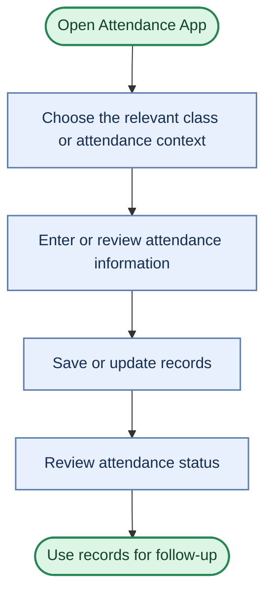

# 🎓 Attendance Management System

  <strong>A smarter, simpler way to manage attendance.</strong> 
  A clean attendance-management experience designed to make tracking and reviewing attendance easier.

  

  
  
  

---

## 👀 Project Preview

  

<i>Application screenshot included in this repository.</i>

## 💡 About the Project

The **Attendance Management System** is a web-based project intended to make attendance tracking more organized and accessible. It provides an application experience for managing attendance-related tasks, with the goal of reducing dependence on scattered manual records.

The project can serve as a foundation for academic attendance workflows involving students, teachers, and administrators.

## ✨ What an Attendance System Helps With

- 📋 **Organized records** — keep attendance information easier to review.
- 👩‍🎓 **Student-focused workflows** — support attendance tracking in an academic setting.
- 🧑‍🏫 **Teaching workflows** — make it easier for teaching staff to review attendance information.
- 📊 **Attendance visibility** — help users understand attendance status and patterns.
- 🖥️ **Web-based access** — open the application through a browser.
- 🔗 **Quick launch** — access the live application directly from this README.

> Feature availability depends on the current version of the live application. The bullets above describe the system's purpose, not a guarantee that every workflow is implemented.

## 🔄 Typical Attendance Workflow

The flow above illustrates a typical attendance-management process. The exact screens and available actions depend on the current app implementation.

## 🎯 Why It Matters

| Challenge | How an attendance system can help |
|---|---|
| Scattered or paper-based records | Keep attendance information in a more organized digital workflow |
| Time spent reviewing records | Make it easier to find and review attendance status |
| Limited visibility | Present records in a way that supports quicker review |
| Follow-up on attendance | Help identify records that may need attention |

## 🌐 Try the Application

  

**Live app:** [Open Attendance Management System](https://ai.studio/apps/680abd2f-edc5-4816-b1b5-febb6c403305?fullscreenApplet=true)

## 🧭 Future Enhancements

Potential improvements for a more complete attendance platform include:

- Secure login and role-based access for students, teachers, and administrators
- Class, subject, and student management
- Daily attendance entry with clear present/absent/late statuses
- Attendance percentage calculation and low-attendance alerts
- Date-based filters and attendance history
- Exportable reports in CSV or PDF
- Mobile-friendly layouts and accessibility improvements
- Secure persistence, validation, and audit trails

## 👨‍💻 Developer

**Kishan H. P.**  
Frontend & Web Developer

- GitHub: [@KishanHP1808](https://github.com/KishanHP1808)
- Repository: [Attendance Management System](https://github.com/KishanHP1808/Attendance-management-system-)

---

  <strong>📅 Better tracking. Clearer records. More time for learning.</strong>  
  ⭐ If you find this project interesting, consider starring the repository.

